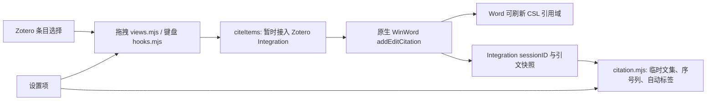

# Zotero CiteFlow 深度审查与优化路线（2026-10-15）

状态更新（2026-10-15）：本文是**工程实现前的审计快照**，下文的“未修改”“未验收”结论仅适用于当时的 HEAD `d2d36fc`。随后已实现 Windows 目标进程判定与临时文集可读占位名，单引号快捷引用经真实 Word 字段验证后按用户意见移除。此次已将验收后的源码提交至 `main`，并更新 `v10` Release 中的 `10.0.0` XPI 和自动更新哈希；版本号未改，标签指针保留原值。当前状态和剩余风险见 [核心技术与维护手册](CORE-TECHNICAL-MAINTENANCE.md) 与 [本次工程验收](VALIDATION-ENGINEERING-2026-10-15.md)。

## 1. 主逻辑与必须守住的边界

核心不变量：Word 引用必须由 Zotero 原生 Integration 创建和刷新；拖拽到非 Word 不应修改任何 Word 文档；文集与标签只能更新对应 session 的数据；“文集显示名”“文献标题”“附件物理文件名”是三种不同属性；设置关闭、插件停用及失败清理后不得留下活动监听或错删已提交的 Word 域。

## 2. 发现与风险登记

| 编号 / 优先级 | 结论与证据级别 | 触发路径、影响、待核实处 | 建议与验收门槛 |
| --- | --- | --- | --- |
| CF-01 / P1 | **可复现机制，具体截图归属仍需关系标记确认。** `citation.mjs:1443-1459` 用随机 `sessionID` 作为临时文集名；`cite.mjs:154-159` 从插件发起 WinWord 命令时传 `docId=null`；`citation.mjs:726-747` 仅在 `docId` 可解析出名字时重命名。截图中的随机名经 Zotero 本地 API 确认为顶层文集 `2UCV8MHQ`，不是附件；图标与插件 Word 文集图标吻合。 | 先由 Zotero 发起拖拽/快捷引用，就可能保留随机名；之后由 Word 发起且提供文档路径的命令才可能改名。须只读核对该文集的 CiteFlow relation marker，避免误将同名普通文集归因于插件。 | 先查清 Word adapter 是否提供可靠的当前文档名称；若没有，使用清晰、唯一的“未识别 Word 文档”占位名并保留 session 映射，待有可信名称再重命名。未确认文档身份时不可猜测最近文件名。测试“插件先发起、Word 后发起、两个文档、关闭重开、同名文档”。详见主方案第 6 节。 |
| CF-02 / P1 | **代码已证实。** `views.mjs:180-221` 依据外部释放坐标、取消标记触发引用，未确认释放目标进程。 | 拖到桌面或其他应用时，若后台有 Word 活动文档，存在误插入可能；真实发生率未实测。`dropEffect=none` 在成功拖进 Word 时也会出现，不能重新作为拒绝条件。 | 先只读验证可靠的目标判定接口，再确定默认行为；Word、非 Word、unknown 和取消的物理拖放负向矩阵都必须过。详见主方案第 3、5 节。 |
| CF-03 / P1 | **验收缺口。** `hooks.mjs:52-70` 有输入/IME/修饰键保护，现有 `settings-behavior` 和 native fixture 使用合成键盘事件及桩 `citeItems`。 | 没有同等级证据证明真实键盘、不同布局/IME、Word 焦点与真实 CSL 域结果；不能称快捷键实机验收完成。 | 用隔离 Zotero/Word 执行物理按键、编辑目标和域刷新矩阵；失败时再提出最小源码修正。详见主方案第 4、5 节。 |
| CF-04 / P2 | **可由代码构造的边界。** `citation.mjs:477-503` 对完整 URL 先 `decodeURIComponent`，再按 `/` 取末段。 | URL basename 含编码斜杠 `%2F` 时可能被拆成另一段，显示名错误；尚未确认真实 Word docId 会传这种 URL。 | 先收集真实 docId 形态；仅对有可信文档路径/URL 的输入解析 basename，再对 basename 解码一次，测试 `%2F`、`%5C`、非法百分号、中文、查询/片段与尾斜杠。 |
| CF-05 / P2 | **静态性能风险。** `citation.mjs:205-238` 启动时遍历用户库全部文集，对每个依次 `loadDataType('relations')`，并删除带临时标记者；`listener()` 会等待该清理。 | 文集很多时可能拖慢启动；用户若手动移动带标记文集，它仍会在后续启动被清理。尚无大文库计时或误删案例。 | 隔离库测 100/1,000/5,000 文集启动耗时；评估先按持久化 key 清理、分批关系检查、清晰告知临时性质。任何优化都须保留异常退出后的垃圾回收能力。 |
| CF-06 / P2 | **有保护但残余风险待故障注入。** `citation.mjs:965-1000` 对索引/条目映射不一致会重读，对双空快照要连续两次确认才清空文集并同步标签。 | Word 忙碌、桥接短暂失效若连续两轮都返回空，仍可能清空插件索引/标签；不会据此断言 Word 域被删。 | 在隔离文档模拟两轮空值、随后恢复、真实删光引用、文档切换和会话过期；区分“已确认空文档”和“读取失败”，保留最后一次可信快照直至状态明确。 |
| CF-07 / P2 | **状态一致性风险。** `citation.mjs:1041-1287` 将自动标签写入 Zotero item，并将归属记录存于插件首选项；两个存储面不能天然形成一笔原子事务。 | 崩溃若发生于 item 保存和归属记录保存之间，可能留下难以辨别的自动标签；现有普通异常回滚不覆盖进程崩溃。 | 先绘制写入顺序/恢复表，再做崩溃点注入；仅清理有明确插件归属的标签，避免触碰用户手工同名标签。量化大文档下的标签扫描和 UI 刷新耗时。 |
| CF-08 / P2 | **兼容性风险。** `views.mjs:110-221` patch Zotero 私有视图方法与拖拽入口；`citation.mjs` 包装 Integration 命令和会话方法。 | manifest 宣称 Zotero 8–11，但当前审查与现场主要基于 Zotero 10.0.6；不同大版本的内部方法/事件语义可能变化。不能把范围声明等同实机兼容。 | 建适配器契约检查与版本矩阵：8、9、10、11 分别启动、停用、拖拽、键盘、Word 域刷新；对第三方插件包装顺序做加载/卸载测试。未测版本如实列为未验证。 |
| CF-09 / P2 | **交付流程风险。** `scripts/build.ps1` 有归档白名单和可重复构建，`tests/package.test.cjs` 主要验 URL/hash 格式；同版本替换 Release asset 时 feed、仓库包与本地包可能漂移。 | 现有测试不能单独证明公开 Release XPI 与 `update.json` SHA-256 匹配，也不能保证已有同版本用户自动更新。不是本轮发现的代码运行时故障。 | 每次获批发布都核对源码提交、XPI 内 manifest、归档白名单、远端 asset SHA-256、feed hash/URL 和 tag 指向；同版本重发需明确安装/更新策略。本轮构建哈希与 feed 匹配，Release 上传后还需核验远端资产哈希。 |

## 3. 跨模块审查结论

- **Word 引用完整性：**`cite.mjs` 通过原生 `Integration.execCommand('WinWord','addEditCitation',null,1)` 插入，不应为了修文集名称改写引用文本或 CSL 域。`citeItems()` 临时包装 `getApplication`/`Session.cite`，并在 `finally` 复原；后续优化应避免扩大这一全局补丁的生命周期。Zotero 10 宿主命令自身有串行防护，但仍需验证第三方包装与多窗口交互。
- **文档身份：**Zotero 10 的 Integration 会话 ID 由随机字符串生成；它不是文件名。原生 WinWord adapter 可取活动文档以执行插入，但当前可见接口并未提供显式、可靠的文件名读取方法。`getDocumentData()` 属引用元数据，不能未经验证当作文档路径。名称识别必须先证明来源与当前 session 对应。
- **设置：**`preferences.mjs` 汇集总开关、快捷引用、拖拽、标签等设置；总开关需要重启，部分子设置即时生效。今后增加“未知目标处理”或“占位名称”应先审查是否确有用户决策价值，不因内部诊断而堆积设置。每项需覆盖默认值、迁移、实时/重启语义、停用清理和说明文案。
- **诊断：**异常路径有 `logError`，但部分数据异常使用 `runtime.log`，只在 debug 开关开启时可见。后续应区分正常空文档、暂时读取失败、明确数据损坏，并设计不泄露条目标题/文档路径的可导出诊断摘要。
- **清理与性能：**会话轮询有活动/空闲节奏，引用刷新有限流与并发合并；这些保护已存在，不能把风险说成“完全没有节流”。建议先测大文库、大文档的启动耗时、内存、Zotero 主线程阻塞和重复 UI 刷新，再决定是否改算法。

### 状态流与故障边界

| 阶段 | 当前状态变化 | 关键不变量 / 故障注入点 |
| --- | --- | --- |
| 发起 | dragend 或 keydown 捕获条目 ID，调用 citeItems；Word Integration 选择活动文档。 | 用户确实指向 Word；没有选中合格条目、取消拖拽、设置关闭时不得发命令。非 Word 目标尚未证明。 |
| 插入 | 临时补丁进入原生 Session.cite；新 Word 域创建并提交后更新引用索引，finally 恢复补丁。 | “未提交的新域”失败时可删除；已提交域不得因稍后的 UI 刷新错误删除。测试 Word 不可用、用户取消、字段提交前后抛错。 |
| 建立会话 | Integration 生成 sessionID；监听/命令钩子确保插件 session、创建临时文集。 | 文集 key 与 session 一一对应；sessionID 是不透明标识，不是文件名；多文档切换不能借当前活动 Word 给旧 session 错命名。 |
| 同步快照 | 读取 citationsByIndex / citationsByItemID，排序并更新文集、序号列和标签队列。 | 数据缺失、双空快照、会话消失和异步迟到结果要分清；旧快照不得覆盖新状态。 |
| 清理 | 关闭/消失的 session 清文集、自动标签；重启时按持久化 key/关系标记清遗留文集。 | 只删插件拥有的数据；普通文集和手工同名标签不可删；失败应可重试并可诊断。 |

### 现有测试能证明什么

| 证据层 | 已有覆盖 | 尚缺的验收 |
| --- | --- | --- |
| Node 单元/模拟 | `settings-behavior` 覆盖开关、合成键盘、拖拽取消与 dropEffect=none；`v40-stability` 覆盖若干显式 docId 重命名与会话路径；`v4002-data/word` 覆盖数据及模拟原生命令分支。 | docId=null 的随机文集默认名、编码分隔符、双文档错名、两轮空快照后的恢复、崩溃时标签归属、第三方包装顺序。测试名和模拟通过不等于桌面 Word 成功。 |
| Native 桥接/Word 检查 | 仓库提供 `test-word-native.ps1`、`native-word-session.ps1`，可检查真实 CSL 域和刷新。 | 这些脚本不能代替 OS 物理拖放落点确认和真实键盘布局/IME 事件；需将输入来源与 Word 域证据关联到同一次测试。 |
| 真实桌面 | 先前的人工 Word 拖放证明某些版本/条件下可插入原生域，且 dropEffect=none 可能是成功结果。 | 非 Word 负向拖放、两个活动文档、随机文集显示名、真实快捷键全矩阵仍无本轮同等证据。此文档不宣称已经验收。 |

优化应先把每个风险转为上述可重复的失败/成功判据，再决定代码改动；尤其不能为了掩盖随机文集名称而改动 citeItems 的原生 Word 插入流程。

## 4. 审批前后的实施顺序

1. **证据补齐（仍不改生产代码）：**只读确认截图文集的插件 relation marker；采集去敏化的 Word `docId` 形态及 Word adapter 可见文档身份；对非 Word 拖放做隔离负向观察；记录现有包的 hash 与真实 Zotero/Word 版本。若接口读取会影响用户文档，只在隔离 profile 中做。
2. **先解决 CF-01 的名称语义：**以 session 归属正确性为第一门槛，确定可用名称来源和安全占位文案，制定双文档/同名/未保存文档状态转换测试。只有方案获用户审批才改代码。物理附件改名不在本问题范围。
3. **CF-02/03 功能验收：**拖拽识别 Spike 和物理键盘验收分别进行；保持已证实的 `dropEffect=none` Word 成功路径。无法可靠识别目标时按审批结果降级，不能默默改动体验。
4. **数据与性能硬化：**先故障注入 CF-06/07，建立可测不变量；再针对测得瓶颈优化 CF-05 和 UI 刷新。不要把这几项和 Word 插入链大规模捆绑。
5. **兼容与交付：**每一项源代码变更独立测试、Rebuild、解包验证、隔离 profile + Word 域验收；发布前核对所有版本/包/远端 hash。用户目前只授权审查方案，尚未授权实施。

## 5. 本轮可交付结论与未解决问题

最明确的新增发现是：截图所示随机名称属于 Zotero 文集侧栏，插件源码的默认文集名称恰为随机 Word sessionID；修复方向应是**文集显示名与文档身份映射**，而不是附件重命名。尚未只读核实该具体文集的 relation marker，也没有证明本机 Word adapter 提供可靠的活动文档文件名。因此计划对“可靠名称”的来源设决策门，不预先指定脆弱实现。

本轮没有运行新的实机拖拽/键盘测试，没有改变插件源代码或 XPI。文档审查仅证明上述代码路径与风险边界；“功能全部正常”仍需隔离 Word/Zotero 实机验收。
